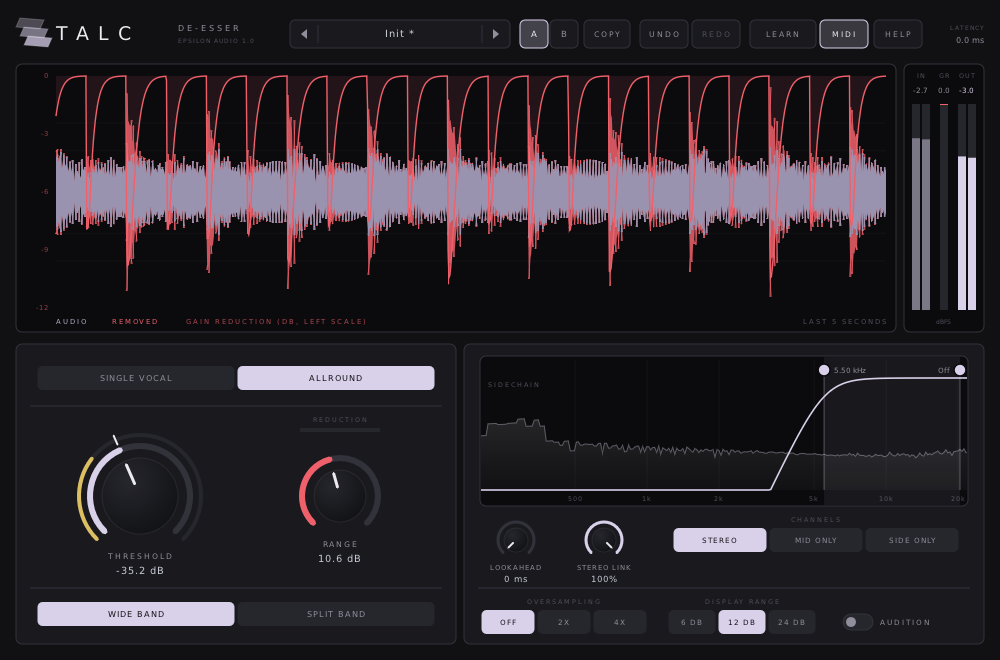
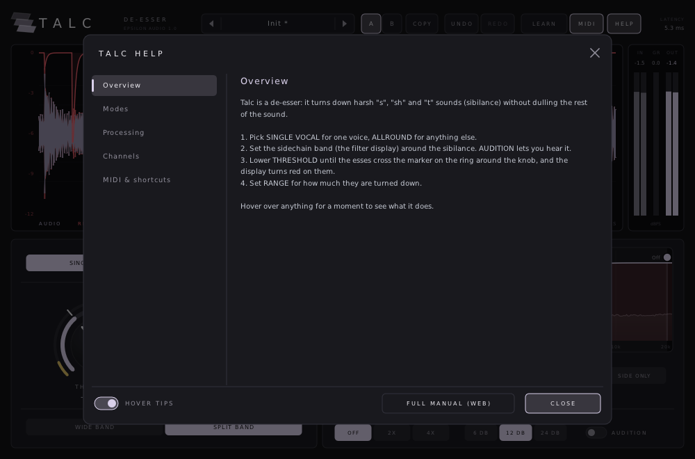

# Talc

**A de-esser with intelligent single-vocal detection, linear-phase split-band processing and a sibilance display, for macOS, Windows and Linux (VST3 · AU · CLAP · VST2).**

Part of **[Epsilon Audio](https://github.com/natehouk/epsilon-plugins)**, a family of free, open-source plugins: Monolith, Caldera, Obsidian, Strata, Basalt, Gneiss, Mica, Flint, Granite, Magma, Schist, Slate and Talc.



Talc is a clean-room design with the feature set of FabFilter Pro-DS, FabFilter's twelfth plugin (October 2012). It was written from scratch, working only from FabFilter's public release announcement and contemporary news coverage. No FabFilter code, binaries, presets, artwork or trademarks were used.

It is part of a family of plugins:
- [Monolith](https://github.com/natehouk/monolith) (synth)
- [Caldera](https://github.com/natehouk/caldera) (filter)
- [Obsidian](https://github.com/natehouk/obsidian) (polysynth)
- [Strata](https://github.com/natehouk/strata) (tape delay)
- [Basalt](https://github.com/natehouk/basalt) (live dual filter)
- [Gneiss](https://github.com/natehouk/gneiss) (compressor)
- [Mica](https://github.com/natehouk/mica) (equalizer)
- [Flint](https://github.com/natehouk/flint) (small filter)
- [Granite](https://github.com/natehouk/granite) (limiter)
- [Magma](https://github.com/natehouk/magma) (multiband distortion)
- [Schist](https://github.com/natehouk/schist) (multiband dynamics)
- [Slate](https://github.com/natehouk/slate) (gate / expander)
- **Talc**, the softest mineral: it smooths the rough edges

## Download

Get the latest build from [**Releases**](../../releases):

| Platform | File | Contains |
|---|---|---|
| macOS 10.13+ (Apple Silicon + Intel) | `Talc-macos-universal.zip` | VST3, AU, CLAP, manual |
| Windows x64 | `Talc-windows-x64.zip` | VST3, CLAP, VST2, manual |
| Linux x64 | `Talc-linux-x64.zip` | VST3, CLAP, VST2, manual |

### Install

| Platform | Copy | To |
|---|---|---|
| macOS | `Talc.vst3` / `Talc.component` / `Talc.clap` | `~/Library/Audio/Plug-Ins/VST3` / `Components` / `CLAP` |
| Windows | `Talc.vst3` (folder) / `Talc.clap` | `C:\Program Files\Common Files\VST3\` / `CLAP\` |
| Linux | `Talc.vst3` / `Talc.clap` | `~/.vst3/` / `~/.clap/` |

**macOS:** builds are notarized once the project's Apple signing credentials are set up. Until then they are ad-hoc signed; after copying, run:

```
xattr -dr com.apple.quarantine ~/Library/Audio/Plug-Ins/*/Talc*
```

## Features

**Two modes**

| Mode | For |
|---|---|
| Single Vocal | One voice. Compares the sibilance band with the whole voice, so bright vowels and breaths don't trigger it |
| Allround | Everything else: groups, instruments, mixes, high-frequency limiting |

**Controls**
- Threshold and range (up to 24 dB), with fast, program-dependent attack and release.
- **Wide band** (turns the whole signal down) or **linear-phase split band** (turns only the sibilance band down; the rest is untouched).
- Sidechain high-pass and low-pass (24 dB/oct), set by dragging handles over a **live spectrum**, with audition.
- Look-ahead up to 15 ms, or zero latency without it.
- Stereo, mid only or side only, with variable stereo linking.
- 2× or 4× linear-phase oversampling of the gain stage.

**Display and workflow**
- **Scrolling de-essing display:** the waveform of the last five seconds with what was removed in red, and the gain reduction.
- **Sidechain level ring** around the threshold knob.
- Input, gain-reduction and output meters.
- A/B with copy, undo/redo for every edit, MIDI Learn.
- Smoothed, sample-accurate automation.
- Resizable interface.
- **22 factory presets** in three categories, plus user presets.
- **Hover tips** everywhere, a **HELP window**, and a **[full manual](docs/MANUAL.md)** (also in every release zip as `Talc-Manual.html`).



### Compared with FabFilter Pro-DS (2012)

| Pro-DS | Talc |
|---|---|
| Single Vocal detection and Allround mode | ✓ |
| Transparent, program-dependent compression/limiting | ✓ |
| Wide band, or linear-phase split band | ✓ |
| Threshold and range | ✓ |
| Adjustable side-chain high-pass and low-pass, with a real-time spectrum analyzer | ✓ draggable band over a live spectrum, plus audition |
| Optional mid-only or side-only processing; adjustable stereo linking | ✓ |
| Look-ahead up to 15 ms | ✓ |
| Up to 4× linear-phase oversampling | ✓ |
| Scrolling waveform that highlights the processed sections | ✓ with gain-reduction line |
| Circular side-chain level meter around the threshold knob | ✓ |
| Large and compact interface sizes | Freely resizable |
| Double-click value entry, MIDI Learn, undo/redo, A/B, smooth parameter changes, help with interactive hints | ✓ hover tips, help pages and full manual |
| Stereo and mono versions | One stereo plugin; use it on mono tracks as usual |
| Pro Tools (RTAS/AAX/AudioSuite) | Not supported (needs Avid's SDK and signing) |

## Build from source

The plugin is built on [DPF](https://github.com/DISTRHO/DPF):

```
git clone --recursive https://github.com/DISTRHO/DPF.git dpf
make -C plugins/Talc                    # Linux / macOS (macOS also builds the AU)
make -C plugins/Talc WINDOWS=true CC=x86_64-w64-mingw32-gcc CXX=x86_64-w64-mingw32-g++
```

GitHub Actions builds all three platforms on every push. The macOS build is universal. It is signed and notarized when the Developer ID secrets are set (`MACOS_CERT_P12`, `MACOS_CERT_PASSWORD`, `NOTARY_KEY`, `NOTARY_KEY_ID`, `NOTARY_ISSUER`), and ad-hoc signed otherwise. A `v*` tag, or a release published on GitHub, attaches the zips to that release.

## Tests

```
cd tests
g++ -O2 -std=c++11 features.cpp -o features && ./features   # transparency, threshold and range, low frequencies ignored, split vs wide band,
                                                            # Single Vocal vs Allround, sidechain low-pass, latency (reported = real),
                                                            # look-ahead, release, link / mid only / side only, audition, oversampling
g++ -O2 -std=c++11 fuzz.cpp -o fuzz && ./fuzz               # random parameters at 44.1-192 kHz: always finite
g++ -O2 -std=c++11 presets.cpp -o presets && ./presets      # plays a synthetic voice with esses through every preset
g++ -O3 -std=c++11 bench.cpp -o bench && ./bench            # CPU, wide and split band, at 1x, 2x and 4x
```

Talc takes about 0.5–1% of one CPU core in wide band and about 2% in split band.

Release checks:
- Steinberg's VST3 validator passes 47/47.
- The interface is exercised with scripted input and a live test mix: presets, the threshold, dragging the sidechain band, modes, tips and help.

## Source layout

| File | Contents |
|---|---|
| `plugins/Talc/TalcEngine.hpp` | All DSP: sidechain filters, detection, gain computer, linear-phase split, look-ahead, oversampling, display history. Header-only |
| `plugins/Talc/ParamDefs.hpp` | Parameter table, labels, value mapping |
| `plugins/Talc/Presets.hpp` | Factory presets |
| `plugins/Talc/UserPresets.hpp` | User preset files |
| `plugins/Talc/Help.hpp` | Hover tip text and in-plugin help pages |
| `plugins/Talc/Fft.hpp` | FFT for the spectrum analyzer |
| `plugins/Talc/TalcPlugin.hpp/.cpp` | Plugin wrapper: parameters, latency, MIDI Learn |
| `plugins/Talc/TalcUI.cpp` | Custom vector interface (NanoVG) |
| `docs/MANUAL.md` | User manual (`Talc-Manual.html` is generated from it with pandoc) |

## License

[MIT](LICENSE). Built with [DPF](https://github.com/DISTRHO/DPF) and its bundled NanoVG, which are under the ISC license. `plugins/Talc/ResizeHandle.hpp` comes from DPF's examples and keeps its ISC notice.

"FabFilter" and "FabFilter Pro-DS" are trademarks of FabFilter Software Instruments. Talc is not affiliated with or endorsed by FabFilter.
